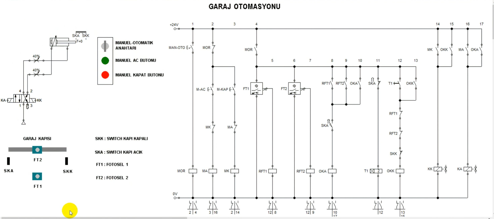
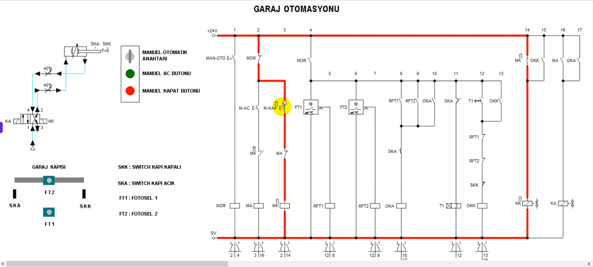
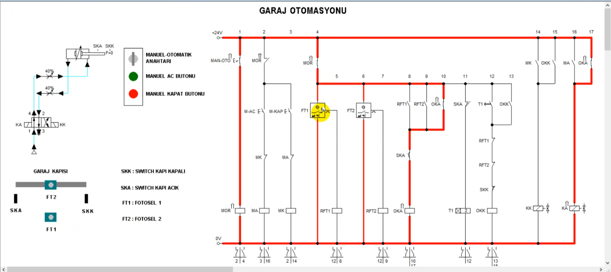
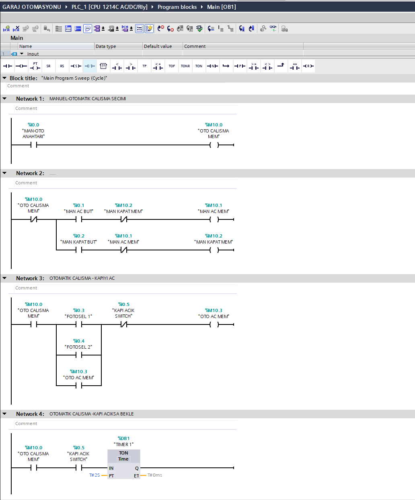
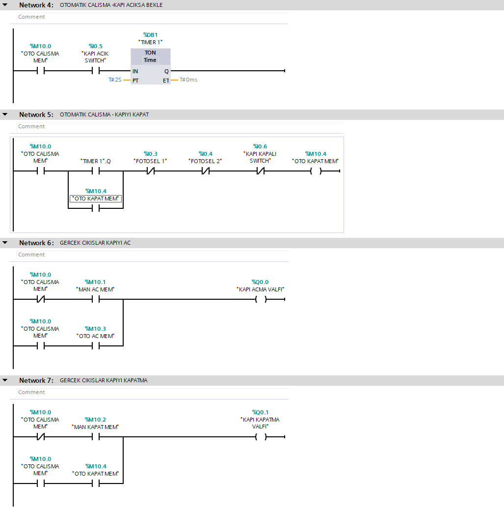
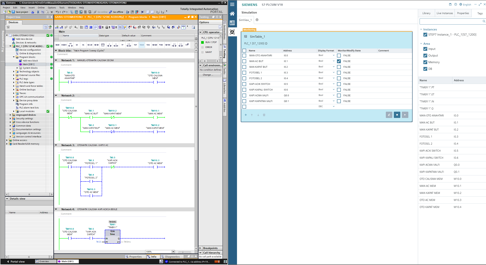
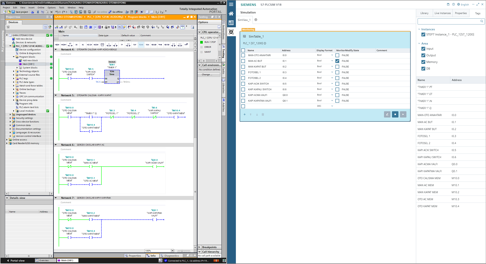
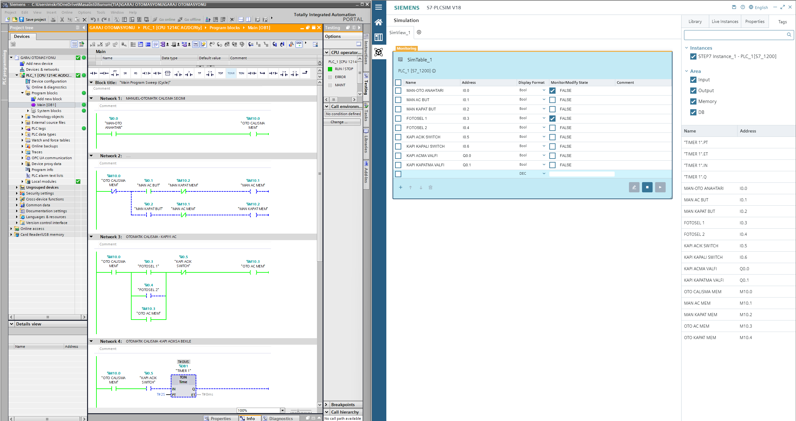

# Garaj Kapısı Otomasyonu | Siemens S7-1200 PLC

Siemens S7-1200 PLC, TIA Portal V18, S7-PLCSIM ve FluidSIM kullanılarak geliştirilen **manuel ve otomatik garaj kapısı kontrol sistemi**.

Bu projede klasik röleli kumanda mantığı incelenmiş, elektropnömatik sistemin çalışma prensibi değerlendirilmiş ve aynı kontrol işlemleri PLC üzerinde Ladder (LAD) programlama diliyle gerçekleştirilmiştir.

## Kullanılan Teknolojiler

- **PLC:** Siemens SIMATIC S7-1200 – CPU 1214C AC/DC/Rly
- **Programlama:** Siemens TIA Portal V18
- **Programlama Dili:** Ladder Diagram (LAD)
- **Simülasyon:** Siemens S7-PLCSIM V18
- **Elektropnömatik Devre:** FluidSIM
- **Kontrol:** Manuel ve otomatik çalışma

## 1. Projenin Amacı

Garaj kapısının manuel butonlar veya otomatik sensörler aracılığıyla açılıp kapatılmasını sağlayan bir kontrol sistemi geliştirmek.

Sistem kapsamında:

- Manuel ve otomatik çalışma modu seçimi
- Manuel açma ve kapatma butonları
- Fotosellerle otomatik kapı açma
- Kapı açık ve kapalı konumlarının algılanması
- Zaman rölesi mantığıyla otomatik kapanma
- Elektropnömatik yön kontrolü
- PLC giriş ve çıkışlarının yönetimi
- Ladder programının PLCSIM üzerinden test edilmesi

işlemleri ele alınmıştır.

## 2. Klasik Kumanda ve Elektropnömatik Devre

Sistemde çift etkili pnömatik silindir, yön kontrol valfi, fotoseller, sınır anahtarları ve kontrol elemanları bulunmaktadır.

Klasik kumanda devresinde manuel ve otomatik kontrol işlemleri röle kontakları, sensörler ve zamanlama elemanları kullanılarak gerçekleştirilir.

## 3. Sistemin Çalışma Prensibi

### Manuel Çalışma

Manuel mod seçildiğinde operatör açma ve kapatma butonlarıyla kapının hareketini kontrol eder.

- Açma butonuyla kapı açma komutu oluşturulur.
- Kapatma butonuyla kapı kapatma komutu oluşturulur.
- Açma ve kapatma komutları birbirinden ayrılır.
- PLC çıkışları üzerinden pnömatik valfler kontrol edilir.

**Manuel kapatma simülasyonu:**

### Otomatik Çalışma

Otomatik modda fotoseller ve kapı konum anahtarları kullanılarak kapının hareketi yönetilir.

1. Fotosel algılamasıyla kapı açma isteği oluşur.
2. PLC açma kontrolünü etkinleştirir.
3. Kapı açık konum anahtarıyla açılma durumu algılanır.
4. TON zamanlayıcı üzerinden bekleme süresi uygulanır.
5. Kapanma koşulları sağlandığında kapatma işlemi başlatılır.
6. Fotosel algılamaları kapanma kontrolünde değerlendirilir.

**Otomatik açma simülasyonu:**

## 4. PLC Giriş ve Çıkış Adresleri

### Dijital Girişler

| Adres | Açıklama |
|---|---|
| %I0.0 | Manuel / Otomatik seçim anahtarı |
| %I0.1 | Manuel açma butonu |
| %I0.2 | Manuel kapatma butonu |
| %I0.3 | Fotosel 1 |
| %I0.4 | Fotosel 2 |
| %I0.5 | Kapı açık konum anahtarı |
| %I0.6 | Kapı kapalı konum anahtarı |

### Dijital Çıkışlar

| Adres | Açıklama |
|---|---|
| %Q0.0 | Kapı açma valfi |
| %Q0.1 | Kapı kapatma valfi |

### PLC Hafıza Bitleri

| Adres | Açıklama |
|---|---|
| %M10.0 | Otomatik çalışma hafızası |
| %M10.1 | Manuel açma hafızası |
| %M10.2 | Manuel kapatma hafızası |
| %M10.3 | Otomatik açma hafızası |
| %M10.4 | Otomatik kapatma hafızası |

## 5. PLC Ladder (LAD) Programı

PLC programı TIA Portal V18 ortamında Ladder (LAD) dili kullanılarak hazırlanmıştır.

Programda kontak mantığı, yardımcı hafıza bitleri, koşullu çıkış kontrolü ve TON zamanlayıcı kullanılmıştır.

### Network 1–4

- Manuel / otomatik çalışma seçimi
- Manuel açma ve kapatma kontrolü
- Fotoseller üzerinden otomatik açma
- Kapı açık konumunda zamanlama

### Network 5–7

- Otomatik kapatma kontrolü
- Manuel ve otomatik açma komutlarının çıkışa aktarılması
- Manuel ve otomatik kapatma komutlarının çıkışa aktarılması

## 6. S7-PLCSIM Simülasyonu

Hazırlanan Ladder programı Siemens S7-PLCSIM V18 kullanılarak simülasyon ortamında incelenmiştir.

Simülasyonda PLC girişleri, çıkışları ve hafıza bitlerinin durumları izlenerek kontrol mantığı değerlendirilmiştir.

### PLC ve PLCSIM Test Ekranı 1

### PLC ve PLCSIM Test Ekranı 2

### PLC Online İzleme

## 7. TIA Portal Proje Dosyası

Projenin TIA Portal V18 arşiv dosyası repository içerisinde bulunmaktadır.

**[TIA Portal V18 – Garaj Otomasyonu Projesini İndir](GARAJ%20OTOMASYONU.zap18)**

Proje arşivi TIA Portal V18 üzerinden açılarak Ladder programı, PLC değişkenleri ve kontrol mantığı incelenebilir.

## 8. Proje Kapsamında Uygulanan Konular

- Siemens S7-1200 PLC programlama
- Ladder (LAD) mantığı
- Klasik kumanda devreleri
- Elektropnömatik kontrol
- Fotosel ve sınır anahtarı kullanımı
- Manuel / otomatik çalışma seçimi
- PLC giriş ve çıkış adresleme
- Hafıza bitleriyle kontrol
- TON zamanlayıcı kullanımı
- S7-PLCSIM ile simülasyon ve online izleme

---

**Geliştiren:** Mustafa Şahin

**Alan:** Elektrik, PLC Programlama ve Endüstriyel Otomasyon
